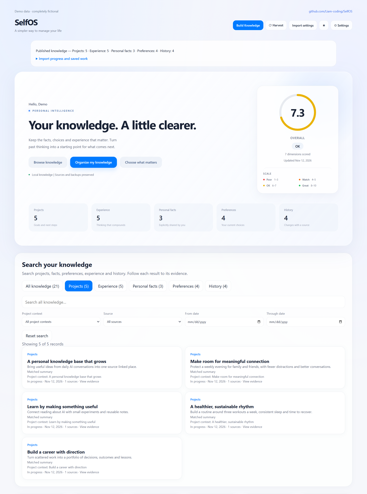

# SelfOS

[English](README.md) | [简体中文](README.zh-CN.md)

[](https://hits.sh/github.com/Liam-coding/SelfOS/)

**Turn AI conversations into knowledge you can use again.**

SelfOS is a local, Markdown-based personal knowledge system. It organizes your Claude Code and Codex conversations into facts, preferences, project context and reusable experience, so your AI assistant can understand what you are working on across sessions.



*Core dashboard with example data.*

[Browse the bilingual synthetic demo](examples/selfos-demo/README.md) or open its HTML pages locally. All demonstration data is fictional.

## Quick start

For tested macOS environments and reproducible checks, see the [macOS compatibility report](docs/macos-compatibility.md).

Requires **Python 3.10+**, Git, and an Anthropic Messages or OpenAI-compatible Chat Completions API for organizing and chat. Local models need tool support. Password hashing uses argon2-cffi; install it with `python -m pip install -r requirements.txt`.

1. Clone the repository:

    ```bash
    git clone https://github.com/Liam-coding/SelfOS.git
    cd SelfOS
    python -m pip install -e .
    ```

2. Optionally create `.env` for Anthropic, or configure your model on the dashboard after starting it:

    ```dotenv
    ANTHROPIC_API_KEY=your-api-key
    # Optional, for a compatible gateway:
    # ANTHROPIC_BASE_URL=https://your-api-endpoint
    ```

3. Start the local dashboard:

    ```bash
    python -m selfos serve
    ```

    Open [http://localhost:7070](http://localhost:7070).
    Log in before accessing the dashboard. Existing vaults require local password initialization with `python -m selfos auth reset`; an empty installation can set its password on the login page. See [authentication](docs/authentication.md).
    Select **Settings > Model and network** to choose the interface, Base URL, model, API key and proxy. Use **Save and test connection** before importing. See [model settings](docs/model-settings.md).

    The interface defaults to English. Choose **Settings > Language** for Simplified Chinese.

4. Open **Import center** to inspect conversation sources, uploaded originals, current tasks and committed results. **Preview a small local sample** enters the bounded setup flow; **Upload or organize files** opens file selection and drag/drop. Opening the center does not scan conversations or call a model. See [import center](docs/knowledge-import.md#import-center).

   Open the chat panel in **Ask knowledge** mode to ask about retained decisions, current work or preferences. Answers include record and original-source links, with separate labels for model interpretation, corrections and history. Project scope, privacy exclusions and bounded requests apply. See [knowledge questions](docs/knowledge-qa.md).

   On a fresh knowledge profile, **Get started** also opens source/exclusion setup and a local preview. **Start sample** processes at most 2 compact parts with a cumulative 12-request allowance. Stop/resume preserves progress and remaining requests. Existing users can reopen setup through **Settings > Resume setup**. See [first-run setup](docs/first-run-onboarding.md).

   **Preview more conversations** offers a separate larger preview without launching all history. The ordinary organizer remains available under **Choose what matters**. Use **Browse knowledge** for published records and original sources.

Before using the vault as agent context, review `vault/PROFILE.md`, `vault/NOW.md` and `vault/GOALS.md` and personalize their contents.

## What SelfOS keeps

| Category | What belongs here |
| --- | --- |
| Personal facts | Explicit statements about your circumstances, linked to source evidence |
| Preferences | Enduring choices; superseded choices move to history |
| Projects | Goals, current state, decisions, blockers and next steps |
| Reusable experience | Reasoning and methods with applicability and limits |
| History | Earlier project states, meaningful outcomes and scoped observations |

You choose the domains and wording detail. Retention follows meaning and evidence, with no target number of final records. Local measurements and configurations stay scoped to their projects rather than becoming universal advice.

Use global search to find records across all categories, filter by project context,
source or date, and inspect matching excerpts and original evidence. See the
[search guide](docs/knowledge-search.md).

## How importing works

SelfOS reads supported local JSONL conversations, filters transient requests and runtime noise, and compacts code and bulk data **only in model input**. It extracts sourced records from session parts, then reviews and consolidates project knowledge.

Three API workers process session parts by default; saves are serialized. Successful work is checkpointed locally. Canonical knowledge is updated only after the complete operation succeeds, with transaction backups. **Original conversations are never rewritten**, and manual notes outside managed sections are preserved.

For a scan without API calls or knowledge writes:

```bash
python -m selfos knowledge --dry-run
```

See the [import and recovery guide](docs/knowledge-import.md) for CLI options, source validation, retries and storage details.

You can also **Upload documents** using the file picker or drop area. UTF-8 .txt and .md files are supported, up to 20 MiB each and 10 files per upload queue. Uploading preserves the original locally and makes no model calls. Choose documents, click **Prepare selected**, then **Organize selected** to process a bounded sample with your configured model; prepare again to continue larger documents. This flow never scans your local conversation history.

Originals live under vault/.knowledge_uploads/originals/, with a content-based registry and rebuildable index. Repeated uploads reuse the same identity. Detected secrets are redacted before indexing and source viewing; privacy exclusions also apply. Uploaded AI descriptions remain quoted evidence rather than verified personal facts. The registry supports 2,000 documents and 512 MiB of originals plus quarantine. Cancelling retains completed uploads; knowledge publication uses existing backups and restore, and migration includes originals only when explicitly selected.

## Stop, resume and undo

- **Stop:** click the stop button. Active requests may still finish saving; wait for the stopped status before closing the server.
- **Resume:** click Organize my knowledge again. Unchanged successful checkpoints are reused. Refreshing or losing the stream also requests cooperative stopping; the page follows the existing saving/stopped task, and remaining work resumes on your next click.
- **Undo:** use the dashboard's undo action or `python -m selfos knowledge --restore-last`. Restore rejects later file edits so it does not overwrite newer changes.

On the next import, changed retention settings trigger a rebuild under the new policy. Completed staging work and backups remain available for recovery; see the [guide](docs/knowledge-import.md#stop-retry-and-restore).


## Review saved knowledge changes

Open **Knowledge changes** from the knowledge browser or a record’s details. Each committed import, correction, undo and backup restore has a traceable operation with before/after values, supporting sources, and independent conflict flags. Temporary extraction checkpoints do not appear here. History snapshots never become additional model context or search results.

Restoring a backup adds a restore event and marks the reversed operation as reverted; it preserves the audit history. Historical sources are checked again against the original bytes and current privacy rules. Legacy vaults start history at their next publication. Direct edits to generated state or the correction ledger are rejected when their hashes no longer match the audit head.

In **Settings → Privacy and migration**, prepare an export with no history, recent complete operations, or all available history. Review its operation count, audit bytes and omitted-history boundary before downloading. Full backups and uploaded originals remain separate options. Exports retain the 64 MiB decoded limit; larger selected ranges fail instead of silently dropping changes.

## Use the knowledge with your AI agent

Your vault combines generated knowledge with Markdown you maintain yourself:

| Path | Purpose |
| --- | --- |
| `vault/PROFILE.md`, `vault/NOW.md`, `vault/GOALS.md` | Personal background, current priorities and goals |
| `vault/02_Work/projects/` | Generated project cards |
| `vault/05_Life/lessons.md` | Reusable experience |
| `vault/knowledge/` | Personal facts, preferences and history |
| `vault/91_Staging/` | Manual agent proposals awaiting review |

Claude Code, Codex and other file-reading agents can use these files as context. Follow the [agent integration guide](docs/agent-integration.md) for setup. Manual agent edits can use the proposal/review workflow; one-click imports use the automatic, backed-up flow described above.

The separate Harvest workflow remains available with `python -m selfos harvest` for conversation digests, staging proposals and the seven-dimension life overview. Details are in the [development guide](docs/dev.md).

## Data use and current limits

Markdown storage and source paths stay local. **Organizing and chat send redacted text and relevant context to your configured API.** Local storage does not imply offline inference, and redaction cannot guarantee removal of every sensitive detail.

Source references make records traceable; AI summaries and candidate reviews do not independently prove accuracy. Multi-project conversations can still lose context. Supported inputs are local Claude Code and Codex JSONL sessions, admitted UTF-8 TXT/Markdown documents, and the pinned OpenCode profile below. Unknown chat-export formats are rejected.

### OpenCode sources

In **Settings → Resume setup → Choose local sources**, add an exact OpenCode database file and save the selection. Discovery only shows candidates; existing permissions stay unchanged. **Preview** reads locally; **Start** explicitly organizes at most two compact parts with a twelve-request allowance. Resume the same preview to retain its remaining allowance. Next page creates another bounded preview; **New scan** archives old progress and includes newer database rows.

The adapter targets the session/message/part projection and info/messages JSON exports in **OpenCode v1.19.5, commit 810c0eba1a7348036f8bdf61e6632d0c36c6876c**. V2-only or unknown schemas are unsupported. Upload supported .json exports through the picker or drop zone. Exports remain quoted evidence, including user-role records; sanitized exports with removed text cannot produce useful knowledge. Native JSON creation time must agree with its ordered SQL creation time.

SQLite transactions are read-only, including committed WAL data; SelfOS never migrates or checkpoints OpenCode storage. Coordinate WAL when copying a live database. Scan limits are 10 seconds, 100 sessions, 2,000 messages and 8 MiB of text; oversized records are diagnosed rather than truncated. Previews use two 40-message pages and at most two sealed parts. Exports are UTF-8, at most 20 MiB and 2,000 messages. SelfOS checkpoints are limited to 8 MiB each and 128 MiB in aggregate.

Progress and archived scans live under vault/.knowledge_harness_scans/; previews use vault/.knowledge_harness/previews/. Admitted originals and processing history use vault/.knowledge_uploads/. Knowledge retains verified source locators and recoverable backups. Restoring knowledge requeues inputs whose canonical completion receipts no longer match. Rebuilding retained native knowledge stops before replacement if its 2,000-message/8 MiB replay allowance is exceeded. Cross-platform migration retains unresolved native permissions and never enables foreign database paths automatically. DeepSeek Harness support awaits identification of its distribution and format; compatibility with every OpenCode release is not claimed.

## Documentation and contributing

| Guide | Covers |
| --- | --- |
| [Import and recovery](docs/knowledge-import.md) | Retention rules, CLI, checkpoints, retries and backups |
| [Project timelines](docs/project-timelines.md) | Trace goals, decisions, progress and blockers to recorded conversations |
| [Knowledge corrections](docs/knowledge-corrections.md) | Edit, delete, merge and undo while preserving sources and respecting later imports |
| [Agent integration](docs/agent-integration.md) | Connecting Claude Code, Codex and other agents |
| [Development](docs/dev.md) | Architecture, endpoints and Harvest workflows |
| [Backend package](docs/backend-architecture.md) | Module boundaries, installation, paths and compatible commands |
| [Frontend structure](docs/frontend-architecture.md) | Packaged templates, styles, browser modules and UI/backend contracts |
| [Internationalization](docs/internationalization.md) | Locale catalogs, adding translations and preserving state during language changes |
| [Evaluation](evals/README.md) | Frozen acceptance cases and model-quality checks |

To run program tests:

```bash
python -m pip install pytest
python -m pytest -q
```

Contributions are welcome, especially new source formats, agent integrations and retention-quality improvements. Keep program-test results and model-quality scores separate, and preserve the frozen evaluation inputs.

Created by [Liam (Jialei Liu)](https://github.com/Liam-coding). Licensed under [MIT](LICENSE).
