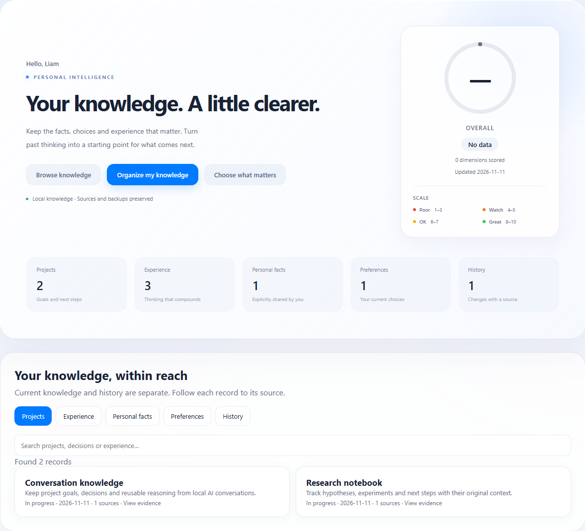

# SelfOS

[English](README.md) | [简体中文](README.zh-CN.md)

**把 AI 对话变成可以再次使用的知识。**

SelfOS 是一个以本地 Markdown 为基础的个人知识系统。它将 Claude Code 和 Codex 对话整理为事实、偏好、项目上下文和可复用经验，让 AI 助手跨会话了解你正在做什么。



*核心页面截图，使用示例数据。*

## 快速开始

已测试的 macOS 环境和复现步骤见 [macOS 兼容性报告](docs/macos-compatibility.md)。

需要 **Python 3.10+**、Git，以及用于整理和聊天的 Anthropic Messages 或 OpenAI-compatible Chat Completions API。本地模型需要支持工具调用。密码哈希使用 argon2-cffi，请先运行 `python -m pip install -r requirements.txt`。

1. 克隆项目：

    ```bash
    git clone https://github.com/Liam-coding/SelfOS.git
    cd SelfOS
    python -m pip install -e .
    ```

2. 可选：为 Anthropic 创建 `.env`；也可以启动后直接在页面配置模型：

    ```dotenv
    ANTHROPIC_API_KEY=your-api-key
    # 使用兼容网关时可配置：
    # ANTHROPIC_BASE_URL=https://your-api-endpoint
    ```

3. 启动本地页面：

    ```bash
    python -m selfos serve
    ```

    打开 [http://localhost:7070](http://localhost:7070)。
    登录后才能访问页面。已有知识库需在本机运行 `python -m selfos auth reset` 初始化密码；空实例可在登录页面设置。详见[登录与恢复](docs/authentication.md)。
    点击 **模型与网络**，填写接口、Base URL、模型名称、密钥和代理，先点击 **保存并测试连接**。详见[模型设置](docs/model-settings.md)。

4. 点击 **关注哪些内容**，选择领域和详细程度，再点击 **整理我的知识**。操作完成后，通过 **查看知识** 浏览内容和来源。

将知识库交给 AI 作为上下文前，请检查 `vault/PROFILE.md`、`vault/NOW.md` 和 `vault/GOALS.md`，将内容调整为你自己的情况。

## 保留哪些内容

| 类别 | 保留标准 |
| --- | --- |
| 个人事实 | 你明确表达的个人情况，并保留来源依据 |
| 偏好 | 持续性的选择；被取代的选择进入历史 |
| 项目 | 目标、当前状态、决策、阻塞和下一步 |
| 可复用经验 | 有适用条件和限制的推理与方法 |
| 历史 | 过去的项目状态、有意义的结果和局部观察 |

你决定关注领域和表达粒度。保留内容由意义和依据决定，不追求最终剩下多少条。局部测量和配置保留项目范围，不直接变成通用建议。

## 整理如何进行

系统读取支持的本地 JSONL 对话，过滤临时请求和运行噪声，**只在模型输入中**压缩代码和大块数据。随后按会话片段提取带来源的记录，再复核和归并项目知识。

默认三路 API 并发处理会话片段，串行保存；成功内容保留本地检查点。整次操作成功后才更新正式知识库，并创建事务备份。**原始对话不修改**，自动生成区域以外的手工备注会保留。

若只想扫描，不调用 API、不写知识库：

```bash
python -m selfos knowledge --dry-run
```

更多 CLI、来源校验、重试和存储说明见[整理与恢复指南](docs/knowledge-import.md)。

## 停止、续跑和撤销

- **停止：**点击停止按钮。已发出的请求可能仍需完成保存；页面显示停止后再关闭服务。
- **续跑：**再次点击整理，复用未变化的成功检查点。刷新或断线也会请求协作停止，页面接回的是当前保存或停止状态；下次点击才继续剩余工作。
- **撤销：**使用页面撤销操作，或运行 `python -m selfos knowledge --restore-last`。恢复会拒绝覆盖导入后的手工修改。

修改保留设置后，下次整理自动按新规则重建。成功的暂存检查点和备份保留以便恢复，详细说明见[指南](docs/knowledge-import.md#stop-retry-and-restore)。

## 让 AI 使用这些知识

知识库同时容纳自动整理内容和你手工维护的 Markdown：

| 路径 | 用途 |
| --- | --- |
| `vault/PROFILE.md`、`vault/NOW.md`、`vault/GOALS.md` | 个人背景、当前重点和目标 |
| `vault/02_Work/projects/` | 自动生成的项目卡 |
| `vault/05_Life/lessons.md` | 可复用经验 |
| `vault/knowledge/` | 个人事实、偏好和历史 |
| `vault/91_Staging/` | 等待审核的手工编辑提议 |

Claude Code、Codex 和其他可读文件的 Agent 都可以读取这些上下文，接入方式见[Agent 指南](docs/agent-integration.md)。手工编辑可采用提议和审核流程，一键整理使用上述自动写入、备份和恢复流程。

原有 Harvest 流程仍可通过 `python -m selfos harvest` 使用，提供对话摘要、staging 提议和七维度生活概览，详见[开发文档](docs/dev.md)。

## 数据使用与当前限制

Markdown 和来源路径保存在本地。**整理和聊天会把脱敏后的文字及相关上下文发送到你配置的 API。** 本地存储不代表离线推理，脱敏也无法保证清除每一种敏感信息。

来源引用提供可追溯性，AI 摘要和候选复核不等于独立验证。多项目对话仍可能漏掉上下文。目前支持本地 Claude Code、Codex JSONL 会话及支持的迁移历史，其他聊天软件导出格式尚未接入。

## 文档与贡献

| 指南 | 内容 |
| --- | --- |
| [整理与恢复](docs/knowledge-import.md) | 保留规则、CLI、检查点、重试和备份 |
| [Agent 接入](docs/agent-integration.md) | Claude Code、Codex 及其他 Agent 的设置 |
| [开发文档](docs/dev.md) | 架构、接口和 Harvest 流程 |
| [后端结构](docs/backend-architecture.md) | 模块职责、包安装、路径与兼容命令 |
| [评测说明](evals/README.md) | 冻结验收案例和模型质量检查 |

运行代码测试：

```bash
python -m pip install pytest
python -m pytest -q
```

欢迎贡献新的来源格式、Agent 接入和知识整理质量改进。代码测试与模型质量分开报告，保留冻结评测输入。

作者：[Liam（Jialei Liu）](https://github.com/Liam-coding)。采用 [MIT 许可证](LICENSE)。
