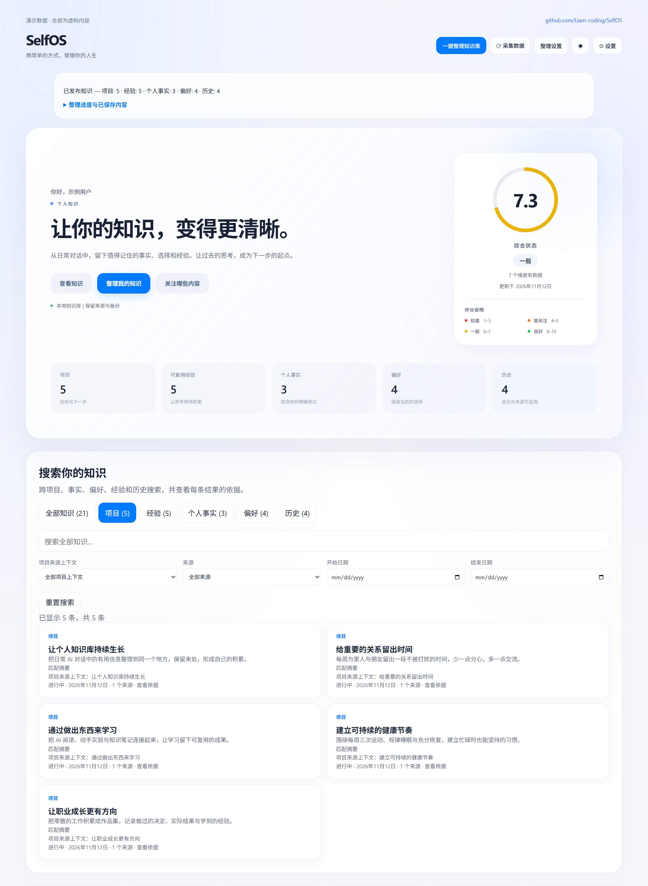

# SelfOS

[English](README.md) | [简体中文](README.zh-CN.md)

[](https://hits.sh/github.com/Liam-coding/SelfOS/)

**把 AI 对话变成可以再次使用的知识。**

SelfOS 是一个以本地 Markdown 为基础的个人知识系统。它将 Claude Code 和 Codex 对话整理为事实、偏好、项目上下文和可复用经验，让 AI 助手跨会话了解你正在做什么。



*核心页面截图，使用示例数据。*

[浏览中英文合成演示](examples/selfos-demo/README.md)，也可以在本地打开对应 HTML 页面。演示内容全部是虚构数据。

## 快速开始

已测试的 macOS 环境和复现步骤见 [macOS 兼容性报告](docs/macos-compatibility.md)。

需要 **Python 3.10+**、Git，以及用于整理和聊天的 Anthropic Messages 或 OpenAI-compatible Chat Completions API。本地模型需要支持工具调用。密码哈希使用 argon2-cffi，请先运行 `python -m pip install -r requirements.txt`。

1. 克隆项目：

    ```bash
    git clone https://github.com/Liam-coding/SelfOS.git
    cd SelfOS
    python -m pip install -e .
    ```

2. 可选：为 Anthropic 创建 `.env`；也可以启动后直接在页面配置模型：

    ```dotenv
    ANTHROPIC_API_KEY=your-api-key
    # 使用兼容网关时可配置：
    # ANTHROPIC_BASE_URL=https://your-api-endpoint
    ```

3. 启动本地页面：

    ```bash
    python -m selfos serve
    ```

    打开 [http://localhost:7070](http://localhost:7070)。
    登录后才能访问页面。已有知识库需在本机运行 `python -m selfos auth reset` 初始化密码；空实例可在登录页面设置。详见[登录与恢复](docs/authentication.md)。
    点击 **模型与网络**，填写接口、Base URL、模型名称、密钥和代理，先点击 **保存并测试连接**。详见[模型设置](docs/model-settings.md)。

4. 打开 **导入中心**，统一查看对话来源、上传的原始文件、当前任务与已写入的结果。**预览少量本地对话**进入有上限的设置流程，**上传或整理文件**打开文件选择与拖放区域。打开导入中心不会扫描对话或调用模型。详见[导入中心](docs/knowledge-import.md#import-center)。

   空知识库也可点击 **开始设置**，选择来源与排除规则、配置模型，再检查本地预览。**启动小样本**最多处理 2 个压缩片段，累计 12 次请求；停止与恢复保留进度和剩余额度。已有用户可通过 **设置 > 恢复设置引导** 重新打开。详见[首次使用引导](docs/first-run-onboarding.md)。

   **预览更多对话**创建独立的扩展预览，不会直接整理全部历史。原有整理功能仍在 **关注哪些内容** 中，发布后通过 **查看知识** 检查内容和原始来源。

将知识库交给 AI 作为上下文前，请检查 `vault/PROFILE.md`、`vault/NOW.md` 和 `vault/GOALS.md`，将内容调整为你自己的情况。

## 保留哪些内容

| 类别 | 保留标准 |
| --- | --- |
| 个人事实 | 你明确表达的个人情况，并保留来源依据 |
| 偏好 | 持续性的选择；被取代的选择进入历史 |
| 项目 | 目标、当前状态、决策、阻塞和下一步 |
| 可复用经验 | 有适用条件和限制的推理与方法 |
| 历史 | 过去的项目状态、有意义的结果和局部观察 |

你决定关注领域和表达粒度。保留内容由意义和依据决定，不追求最终剩下多少条。局部测量和配置保留项目范围，不直接变成通用建议。

全局搜索支持跨分类查找，并按项目来源上下文、来源或日期筛选，查看实际匹配片段和原始依据。详见[搜索说明](docs/knowledge-search.md)。

## 整理如何进行

系统读取支持的本地 JSONL 对话，过滤临时请求和运行噪声，**只在模型输入中**压缩代码和大块数据。随后按会话片段提取带来源的记录，再复核和归并项目知识。

默认三路 API 并发处理会话片段，串行保存；成功内容保留本地检查点。整次操作成功后才更新正式知识库，并创建事务备份。**原始对话不修改**，自动生成区域以外的手工备注会保留。

若只想扫描，不调用 API、不写知识库：

```bash
python -m selfos knowledge --dry-run
```

更多 CLI、来源校验、重试和存储说明见[整理与恢复指南](docs/knowledge-import.md)。

也可以通过 **上传文档** 的选择按钮或拖放区域导入 UTF-8 的 .txt、.md 文件：每份最多 20 MiB，每次上传队列最多 10 份。上传只保存本地原文，不调用模型。选择文件后，点击 **准备选中文件**，再点击 **整理选中文件**，使用配置的模型处理有大小限制的样本；大文件可再次准备以继续整理。该流程不会扫描本地对话历史。

原文保存在 vault/.knowledge_uploads/originals/，另有按内容识别的登记信息和可重建索引，重复上传复用同一身份。建立索引和查看来源前会隐藏检测到的敏感值，并遵守隐私排除规则。上传的 AI 描述保留为引用依据，不直接成为已验证的个人事实。最多登记 2,000 份文档，原文与隔离文件合计最多 512 MiB。取消保留已完成的上传；知识写入沿用备份和恢复流程，迁移仅在明确选择时包含原文件。

## 停止、续跑和撤销

- **停止：**点击停止按钮。已发出的请求可能仍需完成保存；页面显示停止后再关闭服务。
- **续跑：**再次点击整理，复用未变化的成功检查点。刷新或断线也会请求协作停止，页面接回的是当前保存或停止状态；下次点击才继续剩余工作。
- **撤销：**使用页面撤销操作，或运行 `python -m selfos knowledge --restore-last`。恢复会拒绝覆盖导入后的手工修改。

修改保留设置后，下次整理自动按新规则重建。成功的暂存检查点和备份保留以便恢复，详细说明见[指南](docs/knowledge-import.md#stop-retry-and-restore)。

## 查看已保存的知识变化

从知识浏览器或记录详情打开 **知识变化**，查看正式导入、人工纠正、撤销和备份恢复的修改前后内容、支持来源及独立冲突标记。临时整理检查点不会计入历史，历史快照也不会成为额外的模型上下文或搜索结果。

恢复备份会新增恢复事件，并标记被撤销的操作，保留完整的审计过程。查看历史来源时会重新验证原文及当前隐私规则。旧知识库从下一次正式保存开始记录历史；直接改写生成状态或纠正账本导致哈希不匹配时，后续保存会拒绝继续。

在 **设置 → 隐私与迁移** 中准备导出，选择不包含历史、最近若干次完整操作或全部可用历史。下载前可查看操作数量、审计数据大小及省略的历史边界；完整备份和上传原文件仍是独立选项。解码后的导出总量保持 64 MiB 上限，超限会明确报错，不会静默丢弃变化记录。

## 让 AI 使用这些知识

知识库同时容纳自动整理内容和你手工维护的 Markdown：

| 路径 | 用途 |
| --- | --- |
| `vault/PROFILE.md`、`vault/NOW.md`、`vault/GOALS.md` | 个人背景、当前重点和目标 |
| `vault/02_Work/projects/` | 自动生成的项目卡 |
| `vault/05_Life/lessons.md` | 可复用经验 |
| `vault/knowledge/` | 个人事实、偏好和历史 |
| `vault/91_Staging/` | 等待审核的手工编辑提议 |

Claude Code、Codex 和其他可读文件的 Agent 都可以读取这些上下文，接入方式见[Agent 指南](docs/agent-integration.md)。手工编辑可采用提议和审核流程，一键整理使用上述自动写入、备份和恢复流程。

原有 Harvest 流程仍可通过 `python -m selfos harvest` 使用，提供对话摘要、staging 提议和七维度生活概览，详见[开发文档](docs/dev.md)。

## 数据使用与当前限制

Markdown 和来源路径保存在本地。**整理和聊天会把脱敏后的文字及相关上下文发送到你配置的 API。** 本地存储不代表离线推理，脱敏也无法保证清除每一种敏感信息。

来源引用提供可追溯性，AI 摘要和候选复核不等于独立验证。多项目对话仍可能漏掉上下文。目前支持本地 Claude Code、Codex JSONL 会话、上传的 UTF-8 TXT/Markdown 文档和下述固定版本的 OpenCode 格式；未知导出格式会被拒绝。

### OpenCode 来源

在 **设置 → 继续设置 → 选择本地来源** 中添加准确的 OpenCode 数据库文件路径并保存。自动发现只显示候选位置，不改变已有权限。**预览** 仅在本地读取；**开始** 才整理最多两段内容，总请求额度为 12 次。同一预览续跑沿用剩余额度；下一页创建另一份有限预览；**新扫描** 归档旧进度并纳入新增记录。

适配范围为 **OpenCode v1.19.5，提交 810c0eba1a7348036f8bdf61e6632d0c36c6876c** 的 session/message/part 数据结构及 info/messages JSON 导出。未知或仅有 V2 的数据库不支持。上传按钮及拖放框接受支持的 .json 导出。导出文件始终是引用证据，不因角色为 user 提升可信度；正文被移除的脱敏导出无法产生有用知识。原生 JSON 创建时间必须与 SQL 排序时间一致。

SQLite 事务只读，包括已提交的 WAL 内容，不迁移或 checkpoint OpenCode 存储；复制运行中的数据库时需协调 WAL。单次扫描最多 10 秒、100 个会话、2,000 条消息、8 MiB 正文；超限记录显示诊断而不截断。页面预览最多读取两个各 40 条消息的分页、选择两段已封存内容。导出限制为 UTF-8、20 MiB、2,000 条消息。SelfOS 进度文件各不超过 8 MiB，累计不超过 128 MiB。

进度及归档位于 vault/.knowledge_harness_scans/；预览位于 vault/.knowledge_harness/previews/；上传原文和处理记录位于 vault/.knowledge_uploads/。知识保留已校验来源及可恢复备份。恢复知识后，完成凭据不再匹配的输入会重新进入待处理队列。重建已保留的原生知识时，如超过 2,000 条消息或 8 MiB 重放额度，会在替换前停止并保留原知识。跨平台迁移保留未解析的原生来源权限，不会自动启用其他平台路径。DeepSeek Harness 尚待明确发行项目及格式；这里不宣称兼容所有 OpenCode 版本。

## 文档与贡献

| 指南 | 内容 |
| --- | --- |
| [整理与恢复](docs/knowledge-import.md) | 保留规则、CLI、检查点、重试和备份 |
| [项目时间线](docs/project-timelines.md) | 查看目标、决策、进展和阻碍的历史变化及对话来源 |
| [知识纠错](docs/knowledge-corrections.md) | 编辑、删除、合并与撤销，保留来源并尊重后续整理 |
| [Agent 接入](docs/agent-integration.md) | Claude Code、Codex 及其他 Agent 的设置 |
| [开发文档](docs/dev.md) | 架构、接口和 Harvest 流程 |
| [后端结构](docs/backend-architecture.md) | 模块职责、包安装、路径与兼容命令 |
| [前端结构](docs/frontend-architecture.md) | 安装包中的模板、样式、浏览器模块和前后端接口约定 |
| [国际化](docs/internationalization.md) | 语言目录、扩展翻译与切换时的状态保留 |
| [评测说明](evals/README.md) | 冻结验收案例和模型质量检查 |

运行代码测试：

```bash
python -m pip install pytest
python -m pytest -q
```

欢迎贡献新的来源格式、Agent 接入和知识整理质量改进。代码测试与模型质量分开报告，保留冻结评测输入。

作者：[Liam（Jialei Liu）](https://github.com/Liam-coding)。采用 [MIT 许可证](LICENSE)。
